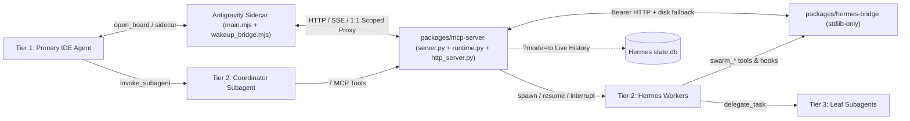

<div align="center">

# Hermes Swarm

**3-Tier Multi-Agent Orchestration for Antigravity IDE + Hermes Agent**

[](https://github.com/MAHDI-AQ/hermes-swarm/actions/workflows/ci.yml)
[](LICENSE)
[](https://www.python.org/)
[](https://nodejs.org/)

*Orchestrate parallel AI coding workers with scoped edit locks, event-driven wakeups, full billable token-economy telemetry, sticky high-volume board feeds, and live click-to-inspect worker history tabs.*

[Quick Start](#-quick-start) · [Install with an AI Agent](#-install-with-your-ai-agent) · [Architecture](docs/ARCHITECTURE.md) · [UI Guide](docs/UI_GUIDE.md) · [Configuration](docs/CONFIGURATION.md)

</div>

---

## Why Hermes Swarm?

Running multiple autonomous AI coding agents reliably requires more than spawning background shells. **Hermes Swarm** combines an Antigravity IDE plugin + Web UI sidecar, a Python MCP + A2A runtime server, and a zero-dependency Hermes Agent plugin into one cohesive control plane:

- **3-Tier Session-Bound Topology (`1 Conversation = 1 Swarm`):**
  - **Tier 1 (User + Primary IDE Agent):** Sets goals, initializes the conversation's isolated swarm, spawns one Coordinator subagent, and receives final verified deliverables.
  - **Tier 2 (Coordinator + Hermes A2A Workers):** Coordinator plans workstreams, locks file scopes (`409` conflict guard), spawns/resumes/hot-swaps models on workers, reviews diffs, and handles blockers.
  - **Tier 3 (Leaf Subagents):** Workers can delegate bounded read/research tasks via Hermes `delegate_task`, tracked in live telemetry without waking upper tiers.
- **Native-Feel Live Agent History Tabs:** Click any worker in the Swarm Board to open a closeable `[● <name> ×]` tab reading Hermes `state.db` (`?mode=ro`) live — complete with collapsible thinking/reasoning blocks, paired tool calls & results, Tier-3 subagent switchers, compaction dividers, and live pulsing tool indicators.
- **Full Billable Token Economy & Honest TPS/CTX:** Tracks per-step **Total Processed** (`input + cacheRead + cacheWrite + output`), **Pure Uncached Input**, **Cached Input**, **Cache Hit %**, **Turn-Delta TPS** (plus streaming `~t/s` fallback), and true model context windows (`config.yaml` + custom providers, preventing premature `256k` compactions on 1M-context models).
- **High-Volume Sticky Board UX (`400+` Messages):** Flex App-Shell keeps headers, billable telemetry strip, and filters permanently pinned at the top while rendering large feeds smoothly via windowing (`120` initial messages + `"Show older"`), `#seq` instant jump, `#jump-top`, and `board_archive.jsonl` pagination.
- **Event-Driven Wakeups & Compaction Resilience:** Sidecar `wakeup_bridge.mjs` wakes sleeping Antigravity coordinators/primaries on `@mentions`; Hermes `post_compaction` / `pre_llm_call` / `pre_verify` / `post_tool_call` hooks preserve swarm identity, scope claims, and read cursors across long-context compactions.
- **Cross-Platform & Zombie-Safe Lifecycle:** Loopback-only (`127.0.0.1`) Bearer-authenticated internal endpoints, gateway `session.interrupt` + `session.close` + orphan process sweeping on `kill_worker`, and HTTP `403` guards blocking killed workers from posting stale updates.

---

## Architecture



---

## ⚡ Quick Start

### Prerequisites
- **Python `>= 3.10`** (`python3` / `python`)
- **Node.js `>= 20`** (for the Antigravity sidecar)
- **Antigravity IDE** and **Hermes Agent (`>= 0.21.4`)** installed locally

### Option A — Human 1-Command Install

**macOS / Linux:**
```bash
git clone https://github.com/MAHDI-AQ/hermes-swarm.git
cd hermes-swarm
./scripts/install.sh
```

**Windows (PowerShell):**
```powershell
git clone https://github.com/MAHDI-AQ/hermes-swarm.git
cd hermes-swarm
.\scripts\install.ps1
```

Then **reload Antigravity** and (if Hermes Gateway is running) restart Hermes Gateway cleanly:
```bash
hermes gateway restart
```

See [docs/INSTALL.md](docs/INSTALL.md) for custom paths, `uvx` / `pip` installation, and troubleshooting.

---

### Option B — Install with Your AI Agent

Copy and paste this into **Antigravity** or **Hermes Agent**:

```text
Clone https://github.com/MAHDI-AQ/hermes-swarm.git, read AGENTS.md and docs/AGENT_INSTALL.md,
run `python scripts/install.py --non-interactive --json`, confirm `python scripts/doctor.py --json`
returns `"ok": true`, and report any actions needed to reload Antigravity / Hermes Gateway.
```

---

## Documentation

- [Human Installation Guide](docs/INSTALL.md) — Windows, macOS, Linux, custom directories, upgrades, uninstall
- [AI Agent Installation Playbook](docs/AGENT_INSTALL.md) — Idempotent CLI flags & JSON contract for automated installs
- [Architecture Reference](docs/ARCHITECTURE.md) — 3-tier topology, A2A runtime, MCP tools, HTTP/SSE routes, wakeup bridge
- [Configuration Reference](docs/CONFIGURATION.md) — All environment variables, ports, timeouts, and context-window resolution
- [Observer UI Guide](docs/UI_GUIDE.md) — Overview, Sticky Feed, Members, Hive Graph, Telemetry Strip, and Live Agent History Tabs
- [Contributing](CONTRIBUTING.md) · [AGENTS.md](AGENTS.md) · [Security Policy](SECURITY.md)

## License

[MIT](LICENSE) © 2026 Hermes Swarm Contributors
